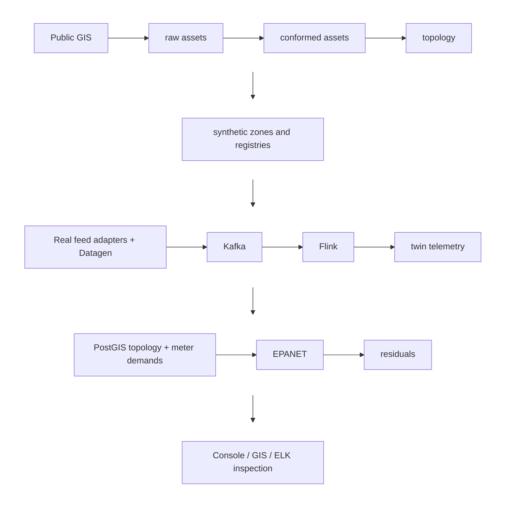

## System boundaries

The Confluent base Compose file supplies Kafka, Connect, Control Center and Flink. Weave’s override supplies Postgres, GIS loading, feed adapters, the simulator, console, features service and ELK services.

The project name is `weave`. Keep active Docker bind mounts in a location that Docker Desktop can access reliably. Website deployment is independent of this stack.

## Data flow

Storage-level observations follow a separate batch path directly into Postgres; a daily reading does not require a Kafka stream.

## Source of truth

PostGIS supplies geometry, spatial seeding and model topology. TimescaleDB stores telemetry in hypertables in the same Postgres system. The model writes element results, residuals and latest DMA state back there.

Logstash polls selected tables into Elasticsearch. The mirrored window is bounded to seven days. Kibana reads that derived copy, not Postgres. Filebeat adds container logs; it excludes the ELK services to avoid feedback loops.

## Read and operation paths

The admin console reads Postgres in read-only transactions and uses existing service endpoints for health. Its operations invoke an allow-listed set of documented commands. One operation runs at a time because seeding, loading and modelling share state.

The optional public console has no Docker socket. Roles and relay routes govern which operations are available. The project website has no connection to those routes.

## Region isolation

Region sources and extent belong in `gis/regions/*.yml`; feed endpoints and IDs belong in `.env`. Do not introduce region coordinates or agency IDs into general code when adding a region.
